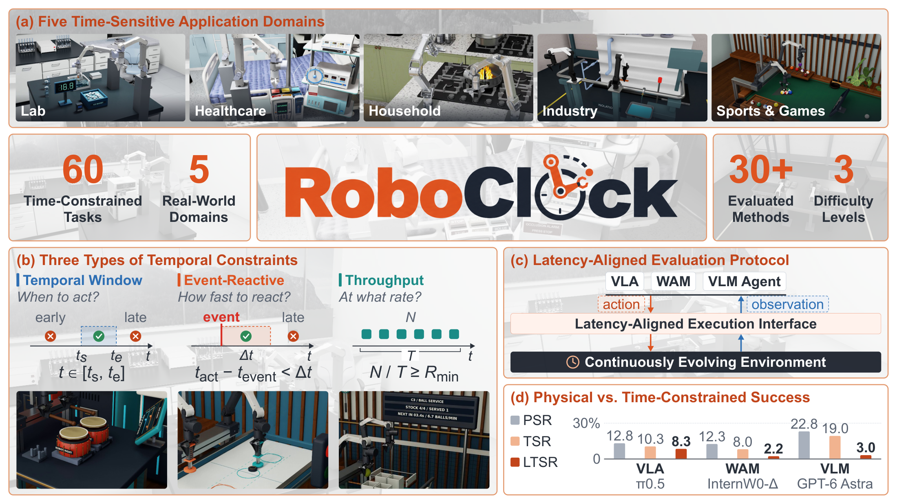
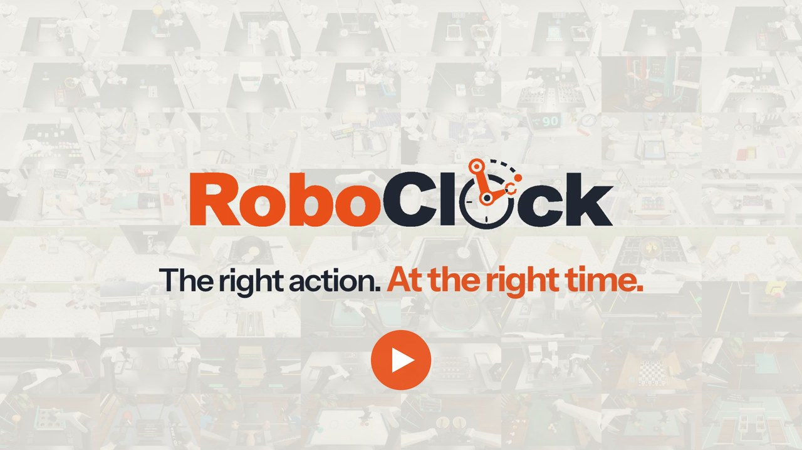
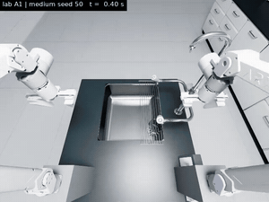
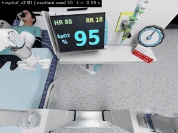
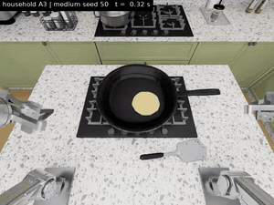
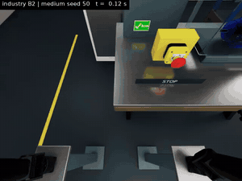
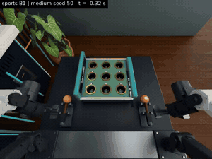
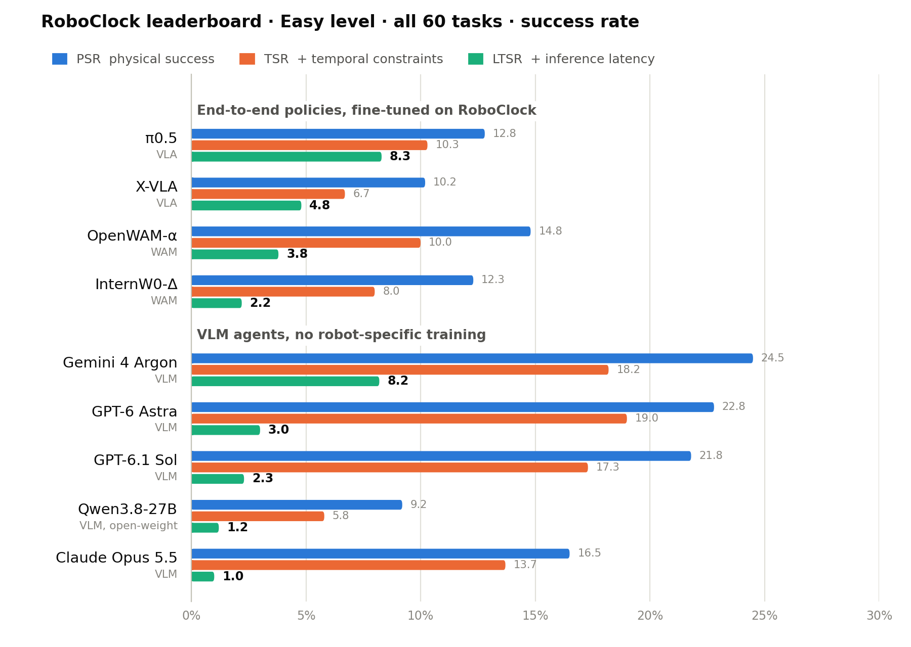

<div align="center">

</img>

<h2 align="center">RoboClock: A Unified Benchmark for Time-Aware Robotic Intelligence</h2>

<h3 align="center"><a href="https://roboclockai.github.io">Webpage</a> | <a href="https://arxiv.org/abs/2611.32233">Paper</a> | <a href="docs/usage.md">Document</a> | <a href="https://roboclockai.github.io/tasks.html">Tasks</a> | <a href="https://huggingface.co/datasets/Roboclockai/roboclock-assets">Assets</a> | <a href="https://roboclockai.github.io/#leaderboard">Leaderboard</a></h3>

<p align="center">
  &nbsp;
  &nbsp;
  &nbsp;
  &nbsp;
  
</p>

</div>

<p align="center">
  </img>
</p>

<p align="center"><em>Overview of RoboClock: 60 time-critical manipulation tasks across five application domains, organized by three types of temporal constraints and evaluated under a latency-aligned protocol.</em></p>

A robot can fail even when every action is physically correct: it acts outside the valid time
window, reacts too slowly to an event, or cannot keep up with the required rate. Existing
benchmarks mostly score spatial correctness and task completion. **RoboClock measures the time.**

## 🎥 Video

<p align="center">
  <a href="docs/videos/roboclock_promo.mp4"></a>
</p>

<p align="center"><em>Click to play the RoboClock video (1 min 50 s), also on the <a href="https://roboclockai.github.io/#demo">project page</a>.</em></p>

## News

- **November 2026** — Released the [RoboClock paper](https://arxiv.org/abs/2611.32233), the code, the [simulation assets](https://huggingface.co/datasets/Roboclockai/roboclock-assets), and one oracle demonstration for each of the 60 tasks.

## ✨ Highlights

- ⏱️ **Three types of temporal constraints** — **Temporal Window** (the target event must happen inside `[t_s, t_e]`; early and late both fail), **Event-Reactive** (respond within `Δt` of a randomized cue), and **Throughput** (sustain `N/T ≥ R_min` over the full time budget).
- 🏥 **60 tasks, five application domains** — laboratory, healthcare, household, industry, and sports & games, with timing grounded in manuals, datasheets, peer-reviewed studies, rulebooks, and public standards.
- 🕰️ **Latency-aligned evaluation** — environment time keeps advancing while the model thinks: each query is charged its measured inference time plus a control-interface delay.
- 📏 **Time-sensitive metrics** — PSR for physical success, TSR for success under all temporal constraints, and LTSR for the same under latency-aligned evaluation.
- 🎚️ **Three difficulty levels** — Easy / Medium / Hard tighten the window width, response limit, or required rate; seeds independently randomize layouts, event onsets, and process parameters, which are revealed only through visual cues.
- 🤖 **One robot interface** — dual ARX X5 on a common side-by-side rig, a head camera and two wrist cameras, 16-D joint-position actions; RoboDojo / [XPolicyLab](https://github.com/XPolicyLab/XPolicyLab) policies plug in directly.
- ✅ **Verified feasible** — a scripted oracle reaches 99.2% joint physical and temporal success; human teleoperators reach 100% PSR and 96% TSR.
- 📉 **Far from solved** — across 30+ evaluated methods, the best end-to-end policy (a fine-tuned π<sub>0.5</sub>) reaches only 8.3% latency-aligned temporal success, even on Easy.

## 🎬 Task Gallery

| Laboratory | Healthcare | Household | Industry | Sports & Games |
| :-: | :-: | :-: | :-: | :-: |
|  |  |  |  |  |
| **A1** · collect water, stop before overflow | **B1** · respond to an SpO₂ desaturation alarm | **A3** · flip the pancake when golden | **B2** · hit the e-stop on a motor fault | **B1** · whack each mole in time |

<p align="center"><em>Head-camera view of the scripted oracle, sped up. Full demonstration videos for all 60 tasks are on the <a href="https://roboclockai.github.io/tasks.html">task page</a>.</em></p>

## 🧩 Tasks

Task IDs encode the constraint type: **A = Temporal Window**, **B = Event-Reactive**, **C = Throughput**.

| Domain | `--env` | Window (A) | Reactive (B) | Throughput (C) | Total |
| :-- | :-- | :-: | :-: | :-: | :-: |
| 🧪 Laboratory | `lab` | 6 | 7 | 3 | 16 |
| 🏥 Healthcare | `hospital` | 4 | 6 | 4 | 14 |
| 🍳 Household | `household` | 4 | 3 | 3 | 10 |
| 🏭 Industry | `industry` | 3 | 3 | 4 | 10 |
| 🏀 Sports & Games | `sports` | 2 | 5 | 3 | 10 |
| **All** | | **19** | **24** | **17** | **60** |

<details>
<summary><b>Full task list</b></summary>

<br>

| Domain | Tasks |
| :-- | :-- |
| Laboratory | A1 water collection before overflow · A2 liquid phase separation · A3 chromatography fractions · A4 titration endpoint · A5 film development · A6 heat-shock transfer · B1 hotplate over-temperature · B2 thermal short circuit · B3 motor stall isolation · B4 tipping test tube · B5 freezer door alarm · B6 vacuum bumping relief · B7 waste carboy overflow · C1 test-tube sorting · C2 rack loading · C3 calibration placement |
| Healthcare | A1 IV roller clamp · A2 sequential bag switch · A3 bag-valve ventilation · A4 hang bag then start pump · B1 SpO₂ desaturation · B2 AED pads · B3 hazardous drug spill · B4 ventilator reconnection · B5 anaphylaxis auto-injector · B6 haemorrhage tourniquet · C1 pharmacy order picking · C2 OR instrument turnover · C3 crash-cart restock · C4 specimen station surge |
| Household | A1 sugar pour · A2 ice dispenser · A3 pancake flip · A4 kettle pour to weight · B1 faucet surge · B2 rolling-object catch · B3 oil fire · C1 serving order · C2 two-arm cola pour · C3 cutlery sorting |
| Industry | A1 pick-and-dip · A2 carrier placement · A3 adhesive cover seating · B1 coolant leak shut-off · B2 motor fault e-stop · B3 QC reject · C1 maintenance kitting · C2 carton shelving · C3 part weighing · C4 eyeshadow palette filling |
| Sports & Games | A1 chess move + clock · A2 basketball · B1 whack-a-mole · B2 boxing pads · B3 bench-press spotting · B4 stop/go puck · B5 taiko · C1 pool racking · C2 speed cups · C3 ball service |

</details>

## 🚀 Quick Start

**1. Install** (Isaac Sim 5.1, Python 3.11, Linux, NVIDIA RTX GPU)

```bash
git clone https://github.com/roboclockai/roboclock.git && cd roboclock
python3.11 -m venv .venv && source .venv/bin/activate
pip install -r requirements.txt        # Isaac Sim via NVIDIA's package index
export OMNI_KIT_ACCEPT_EULA=YES
```

**2. Download the rendering assets** (2.2 GB, [non-commercial use only](https://huggingface.co/datasets/Roboclockai/roboclock-assets))

```bash
hf download Roboclockai/roboclock-assets --repo-type dataset --local-dir ../roboclock-assets
rsync -a --exclude README.md --exclude .gitattributes --exclude .cache ../roboclock-assets/ ./
mkdir -p src/roboclock/envs/household/assets/x5/lightwheel_kitchen
ln -sfn ../../../../../../../assets/household/lightwheel_kitchen/Collected_KitchenRoom \
  src/roboclock/envs/household/assets/x5/lightwheel_kitchen/Collected_KitchenRoom
roboclock doctor                         # checks the runtime and the assets
```

**3. Run**

```bash
# list tasks and run the scripted oracle on one task
roboclock tasks --env lab
roboclock eval --env lab --policy oracle --oracle --task A1 --difficulty easy --seeds 1

# evaluate your policy on every task and difficulty, 10 seeds each
roboclock eval --env lab --policy my_policy:Policy --task all --difficulty all --seeds 10
roboclock summarize results/<run>/episodes.jsonl
```

See the [usage guide](docs/usage.md#installation) for Isaac Sim 6.0.1, standalone Isaac Sim installs, and GPU/driver requirements.

## 🔌 Policy Integration

A policy is any Python factory passed to `--policy module:Factory`. It receives only observations, never simulator or scoring state:

```python
class Policy:
    def reset(self, observation):
        pass

    def act(self, observation):
        # observation: rgb, depth (optional), left_wrist_rgb, right_wrist_rgb, joint_positions (16),
        #              ee_pose (14), gripper_width (2), instruction, sim_time
        # returns 16 joint targets: left arm (6 joints + 2 fingers), then right arm
        return observation["joint_positions"].copy()
```

- **Remote policies.** Policies served through [XPolicyLab](https://github.com/XPolicyLab/XPolicyLab) on RoboDojo's `arx_x5` layout run unchanged; launch scripts for π<sub>0.5</sub>, X-VLA, WALL-OSS, InternW0, OpenWAM and others are in [`scripts/xpolicylab/`](scripts/xpolicylab/).
- **VLM agents.** Hosted and local vision-language models act through tool-calling agents; see [vision-language agents](docs/vision-llm-agent.md).
- **Time model.** Every model query is charged its measured inference time in simulation time, which gives LTSR. `--inference-latency zero` pauses the clock during inference instead, which gives TSR.

## 🏆 Leaderboard

Leading methods of each family on the Easy level, over all 60 tasks. Each step from PSR to TSR to LTSR adds a requirement: complete the task, complete it on time, and complete it on time while the clock keeps running during inference.

<p align="center">
  <picture>
    <source media="(prefers-color-scheme: dark)" srcset="docs/images/readme/leaderboard-dark.png">
    
  </picture>
</p>

<details>
<summary><b>Numbers behind the chart</b></summary>

<br>

| Method | Family | PSR | TSR | LTSR |
| :-- | :-- | :-: | :-: | :-: |
| π<sub>0.5</sub> (fine-tuned) | VLA | 12.8 | 10.3 | **8.3** |
| X-VLA (fine-tuned) | VLA | 10.2 | 6.7 | 4.8 |
| OpenWAM-α (fine-tuned) | World-action model | 14.8 | 10.0 | 3.8 |
| InternW0-Δ (fine-tuned) | World-action model | 12.3 | 8.0 | 2.2 |
| Gemini 4 Argon | VLM agent | 24.5 | 18.2 | 8.2 |
| GPT-6 Astra | VLM agent | 22.8 | 19.0 | 3.0 |
| GPT-6.1 Sol | VLM agent | 21.8 | 17.3 | 2.3 |
| Qwen3.8-27B (open-weight) | VLM agent | 9.2 | 5.8 | 1.2 |
| Claude Opus 5.5 | VLM agent | 16.5 | 13.7 | 1.0 |

</details>

Success rates in %, from the [paper](https://arxiv.org/abs/2611.32233). PSR = physical success, TSR = success under all temporal constraints with inference paused, LTSR = the same with inference latency charged to the environment clock. VLM agents act through the tool-augmented end-effector interface. For reference, the privileged scripted oracle reaches 99.2% joint physical and temporal success over all three difficulty levels. The full, searchable table for 30+ methods is on the [RoboClock leaderboard](https://roboclockai.github.io/#leaderboard); the chart is drawn by [`scripts/readme/leaderboard_chart.py`](scripts/readme/leaderboard_chart.py).

## 📚 Documentation

| Section | Description |
| :-- | :-- |
| [Usage guide](docs/usage.md) | Installation, per-domain environments, evaluation CLI, scoring rules, and rendering/physics validation. |
| [Installation](docs/usage.md#installation) | Isaac Sim 5.1 (Python 3.11) or 6.0.1 (Python 3.12) setup and asset download. |
| [Running policies and evaluation](docs/usage.md#running-policies-and-evaluation) | `roboclock eval`, the policy interface, and result artifacts. |
| [Time model](docs/architecture.md#inference-latency) | Block-and-replay latency charging, `--control-delay`, and the optional streaming mode. |
| [Scoring](docs/usage.md#scoring) | Physical, temporal, and joint success; latched violations; throughput accounting. |
| [Robot rig](docs/robodojo-rig-spec.md) | Dual ARX X5 rig, cameras, and the RoboDojo-compatible action/observation layout. |
| [Demonstrations](https://roboclockai.github.io/tasks.html) · [collection](docs/demo-collection.md) | Oracle demos and how to re-collect them. |
| [XPolicyLab policies](docs/xpolicylab-pi05.md) | Serving π<sub>0.5</sub> and other XPolicyLab policies against RoboClock. |
| [Vision-language agents](docs/vision-llm-agent.md) | Hosted VLM/LLM agents as policies. |
| [Browser teleoperation](docs/teleop.md) | Human teleoperation through a browser. |
| [Assets](https://huggingface.co/datasets/Roboclockai/roboclock-assets) | Scenes, models, and textures with provenance, distributed as a Hugging Face dataset. |

## 🗂️ Repository Structure

```text
src/roboclock/envs/        five domains (lab, hospital, household, industry, sports) + shared rig
src/roboclock/evaluation/  episode runner, time model, metrics, summaries
src/roboclock/policies/    policy interface, VLM agents, teleoperation
src/roboclock/cli.py       `roboclock` entry point (tasks, plan, eval, summarize, render, ...)
scripts/                   per-domain asset preparation, demo collection, XPolicyLab servers
docs/                      usage guide and design notes
tests/                     unit and contract tests
assets/                    scenes, models, and textures (downloaded from the roboclock-assets dataset)
```

## 📝 Citation

```bibtex
@article{zhao2026roboclock,
  title={{RoboClock}: A Unified Benchmark for Time-Aware Robotic Intelligence},
  author={Zhao, Yujie and Hu, Anthony L. and Huang, Zimeng and Wu, Zhijing and Wang, Luobin and Li, Richard and Sudharsan, Shrivas and Christensen, Henrik I. and Zhao, Jishen},
  year={2026},
  url={https://roboclockai.github.io}
}
```

## 🙏 Acknowledgements

RoboClock builds on [Isaac Sim](https://developer.nvidia.com/isaac/sim), [RoboDojo](https://github.com/RoboDojo-Benchmark/RoboDojo), [XPolicyLab](https://github.com/XPolicyLab/XPolicyLab), [Lightwheel Kitchen](https://lightwheel.ai/), and [RoboCasa](https://robocasa.ai/), and on CC0 / CC BY assets from OpenGameArt, Sketchfab, and Objaverse; per-asset provenance is listed in the [assets dataset](https://huggingface.co/datasets/Roboclockai/roboclock-assets). We thank their authors and maintainers.

## ⚖️ License

The code is released under the [MIT License](LICENSE). The simulation assets are a separate download for **non-commercial use only**; third-party assets keep their original licences and attribution requirements, listed on the [dataset card](https://huggingface.co/datasets/Roboclockai/roboclock-assets).
