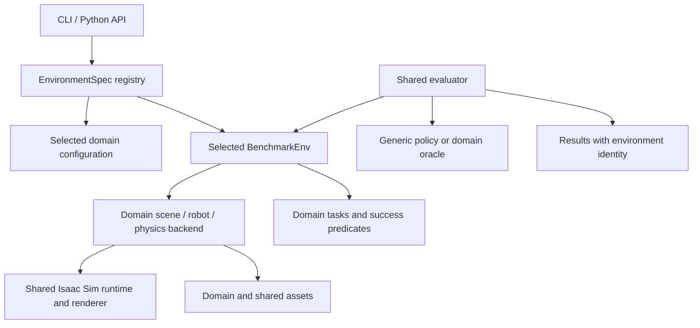

# Multi-environment architecture and extension contracts

RoboClock organizes code by environment domain. The five benchmark domains are
`lab`, `household`, `hospital` (healthcare), `sports` and `industry`; the frozen
`hospital` remains registered for its own tests and recordings. Every domain uses only the
Dual ARX X5: the single-Franka `chess` and `sports_legacy` environments were removed on 2026-11-21.
Each domain owns its scene, tasks, configuration, controllers, and assets, and
uses the shared registry, CLI, simulator utilities, evaluator and result schema.
`tests/test_domain_contract.py` checks that the five domains keep this contract.

```text
pyproject.toml                  Package metadata and dependency groups
requirements.txt                Isaac Sim installation entry point
MANIFEST.in                     Configuration and asset packaging rules
src/roboclock/
├── cli.py                      Shared commands and --env selection
├── config.py                   Environment-specific configuration dispatch
├── resources.py                Shared and domain asset resolution
├── envs/
│   ├── base.py                 BenchmarkEnv public contract
│   ├── spec.py                 EnvironmentSpec declarations
│   ├── registry.py             Registration, plugin discovery, lazy factories
│   └── lab/
│       ├── spec.py             Laboratory registration
│       ├── env.py              Dual ARX X5 actions and observations
│       ├── backend.py          Scene, PhysX, robot, and sensors
│       ├── layout.py           Seeded task layout
│       ├── clutter.py          Seeded non-task tabletop rigid bodies
│       ├── appearance.py       Equipment, materials, and labels
│       ├── config.py           Validation and EpisodeSpec sampling
│       ├── configs/            Laboratory YAML configuration
│       ├── mdp/                State, process events, and task predicates
│       ├── tasks/              Task base classes, registry, and A/B/C tasks
│       ├── policies/           Trajectories and diagnostic oracle
│       ├── validation.py       Physics probes and image export
│       ├── videos.py           Offline recording of actual episodes
│       └── assets/             Catalog, textures, provenance, and licenses
├── simulators/isaac/            Kit lifecycle, diagnostics, rendering, meshes
├── physics/                    Shared contacts, rotation, and pose math
├── tasks/registry.py            Domain-scoped task dispatch
├── policies/base.py            Policy loading and hold baseline
├── evaluation/                 Plans, latency, metrics, result schema, validation dispatch
└── assets/shared/              Cross-domain resources, currently HDR lighting
scripts/lab/                    Texture generation and fixture probes
tests/envs/lab/                 Laboratory predicates and environment tests
tests/simulators/isaac/          Shared Isaac utilities
tests/test_environment_registry.py  Domain isolation and plugin contracts
tests/test_domain_contract.py   Five-domain registration, planning and result-schema contract
docs/                           Architecture, material notes, validation evidence
data/<env>/<task>/               One oracle demonstration per task (scripts/collect/promote_demos.py)
skills/build-robotics-simulation/ Simulation authoring skill and references
```

## Dependency definitions and generated files

`pyproject.toml` defines package dependencies once. Its `sim` extra supplies
Isaac Sim 5.1.0; `dev` supplies pytest and Ruff. `requirements.txt` selects the
editable package with `sim` and NVIDIA's package index. Use Python 3.11 for the
simulator; lightweight planning and tests also support Python 3.12.

`MANIFEST.in`, together with setuptools' `include-package-data`, packages domain
and shared configuration, assets, and licenses into source distributions and
wheels. Independent domain plugins package their own resources.

Generated runs belong under the ignored `results/` directory. `build/`, `dist/`,
Python bytecode, test/lint caches, and editable-install metadata are also ignored.
Selected recordings live in `data/`; documentation images and historical
validation evidence remain in `docs/` with their original configurations and
hashes. Keep one canonical copy of each documentation preview.

## Runtime and dependency direction



Shared commands, evaluation, and policy loading use registration declarations;
they do not import the laboratory backend or oracle directly. Specs contain
paths and import strings, so listing environments does not start Isaac Sim.
When simulation is requested, construct `SimulationApp` before importing
Isaac/Omniverse modules.

```bash
roboclock envs
roboclock tasks --env lab
roboclock plan --env lab --task all --difficulty all --seeds 10
roboclock smoke --env lab --task A1 --steps 5
roboclock render --env lab --task C2
roboclock eval --env lab --policy oracle --oracle
```

Omitting `--env` selects `lab`. Default outputs are
`results/<env>/render.png`, `results/<env>/physics/`, and
`results/<env>/<run-id>/`; an explicit `--output` takes precedence.

```python
from roboclock.envs import create_env

env = create_env("lab", task_id="A1", difficulty="easy")
observation, info = env.reset(seed=0)
```

The runtime supports one active environment per process. Environments can run
sequentially under a shared runtime; parallel cloning is not implemented. Kit's
fast shutdown exits the process, so close the runtime only after simulation,
artifact writes, and video encoding finish.

## Adding an environment

1. Add the implementation under `envs/<name>/`: its environment, backend,
   configuration, tasks, controllers, and assets. Reuse shared physics and
   simulator utilities where they apply.
2. Declare `SPEC = EnvironmentSpec(...)` in `spec.py`, providing the name,
   factories, task registry, configuration loader, default configuration,
   asset root, default task, and difficulties. See
   [lab/spec.py](../src/roboclock/envs/lab/spec.py). Keep declarations free of
   simulator startup side effects.
3. Add built-in domains to `_BUILTIN_SPECS` in `envs/registry.py`. Temporary
   integrations can call `register_environment(SPEC)` before `main()` or
   `create_env()`; shared commands and evaluation need no domain-specific edits.
4. Implement the public contract and add tests under `tests/envs/<name>/`.
   Add the domain and its recorded results to `tests/test_domain_contract.py`.

An independent package can expose an environment through an entry point:

```toml
[project.entry-points."roboclock.environments"]
kitchen = "my_kitchen.spec:SPEC"
```

This is an extension example, not an implemented kitchen domain. The entry-point
name must match `EnvironmentSpec.name`. Names use lowercase letters, digits,
and underscores; duplicate registrations fail instead of replacing a domain.

## Environment and task contracts

`BenchmarkEnv` follows Gymnasium's `reset()`, `step()`, observation-space, and
action-space conventions, and requires:

| Interface | Purpose |
|---|---|
| `environment_id` | Domain name matching its registration |
| `config`, `oracle`, `done` | Configuration, privileged-policy mode, episode status |
| `advance_latency(seconds)` | Replay inference latency: advance physics under the previous joint targets, rounded up to a physics tick ([Inference latency](#inference-latency)) |
| `benchmark_metadata()` | JSON metadata describing simulator and assets |
| `episode_metadata()` | Domain-specific scene, robot, and initial-state metadata |
| `task` | Timing, termination, instructions, and scoring used by evaluation |

CLI factories accept `task_id`, `difficulty`, and keyword arguments `runtime`,
`config_path`, `asset_catalog`, `depth`, and `oracle`. The five benchmark domains also
accept `start_pose` ([Start pose](#start-pose)). `reset(options=...)` must
honor `task_id` and `difficulty`: the evaluator builds one environment for the
first planned task and resets it for every episode of the plan.

The five benchmark domains share the Dual ARX X5 interface, so one policy can be
evaluated on all of them:

| Space | Shape | Content |
|---|---|---|
| action | 16 | joint-position targets, `left/joint1..8` then `right/joint1..8` (six arm joints, two fingers), limits from `envs/lab/robot.py` |
| `rgb` | H×W×3 uint8 | task camera |
| `joint_positions` | 16 | measured positions, action order |
| `ee_pose` | 14 | per arm: position xyz and orientation quaternion |
| `gripper_width` | 2 | per arm |
| `sim_time` | 1 | physics simulation time |
| `instruction` | text | task instruction, separate from the image |

`depth` is optional. `step()` applies one control period and returns
`float(task.joint_success)` as its reward. The legacy `hospital` keeps its own spaces. The shared `hold` policy only expects `joint_positions`.

Task registries map IDs to classes exposing `name`, `category`, and `discipline`.
Factories accept `(task_id, difficulty, seed, config)`. Task `spec` must be a
dataclass with `max_time`, because planning serializes it with
`dataclasses.asdict()`. Task IDs number tasks by class in every benchmark
domain: A = `temporal_window`, B = `event_reactive`, C = `throughput`.

Evaluation uses task `time`, `terminated`, `spec.max_time`, `event_log`,
`gen_instruction()`, and `metrics()`. Shared configuration reads `sim.physics_dt`,
while Isaac startup reads `visuals.renderer`, defaulting to `RaytracedLighting`.
Other validation belongs to the domain's configuration loader.

Task IDs are unique within a domain; two environments can both define `A1`.
Plans and results retain `environment`, and summaries include environment-aware
task keys and `by_environment`. Older records without that field are grouped as
`unspecified` rather than assumed to be laboratory results.

### Start pose

By default every task starts from its own arm posture: lab and hospital `HOME`,
household `READY_Q`, and IK pre-positions in hospital, industry and sports (a hand
hovering over a key, an arm parked aside). RoboDojo episodes instead start with all six
joints of both arms at 0.

`roboclock eval --start-pose zero` (config `robot.start_pose: zero`, env argument
`start_pose="zero"`, module `roboclock.envs.start_pose`) starts both arms at joint 0 in
every task of the five domains. Joints 1-6 and their PD targets are set at reset,
before the episode clock starts. Each gripper keeps its task's start width, and arms the
environment drives itself, such as the sports A1 opponent, keep their posture. The
manifest's `config` and every episode row record `start_pose`.

At zero the X5 is folded: each tool points forward, horizontally, about 0.24 m ahead of
and 0.16 m above its base. An Isaac check on 2026-11-07 reset all 60 tasks (easy, seed 0)
this way and held the arms for 2 s. Every arm joint started within 0.007 rad of 0 and
drifted at most 0.008 rad. No task reported a collision or a physical failure, and none
ended early.

The tasks, deadlines, oracles and recorded demonstrations were authored for the task
postures. So `zero` is an evaluation setting for policies trained on RoboDojo, not a task
change. Known conflicts:

- sports B3 starts away from its standby pose. Leaving standby before the stall is allowed
  (only touching the bar or closing the jaws early fails), so this only costs the policy
  the time to reach the bar.
- Tasks whose start pose puts a hand at the action leave a policy less time. These are
  hospital A1-A3 (hovering at the roller, selector or STOP key), industry B3 (hand
  waiting over the bearing lane) and C2 (pre-grasp at the first carton), lab B3, B4 and B6
  at short deadlines, and sports B2 (guard pose).
- Oracles command tool-down orientations and may miss deadlines or IK checks from zero.

A domain oracle is declared through `oracle_factory` and requires explicit
`--oracle`. Custom policies receive observations without evaluator or full
physical state. Rendering and probes dispatch through an optional
`validation_module`; domains without one receive a clear error. `--rack-probes`
currently selects a laboratory-specific probe.

## Time base

[envs/rates.py](../src/roboclock/envs/rates.py) holds the rates every domain shares,
and each domain's config loader rejects anything else through `check_rates`.

| Layer | Rate | Notes |
|---|---|---|
| Physics | 250 Hz | Exactly 250 Hz in every task (RoboDojo rig spec) |
| Environment step and oracle | 50 Hz | `step()` is one 20 ms control period |
| Policy | 50 or 25 Hz | `roboclock eval --policy-hz 25` |
| Recording | 25 fps by default | The recorder fps must divide 50 Hz |

Ground-truth demonstrations come from the oracles, so they are 50 Hz.

With `--policy-hz 25` each action spans two environment steps. The evaluator ramps
the joint targets linearly from the previous action to the new one, and the policy
sees the observation at the end of the second step. Oracles integrate their rate
limits per control tick, so they only run at the control rate.

Recordings under `data/` predate this time base and keep their original rates.

### Inference latency

`roboclock eval` uses one time model for every domain (block-and-replay). Simulation
is blocked while the policy computes; the inference time is then replayed in
simulation. Each cycle:

1. The policy receives the observation sampled at environment time t_obs. Its
   camera images render when the policy first reads them (see "Rendering on read").
2. The inference latency L of `act()` is measured. A policy may report its model
   time in `last_inference_latency` (seconds) to leave out transport. The
   XPolicyLab client reports the server's `latency_ms`. Otherwise the wall-clock
   time of `act()` counts, minus the time spent rendering the observation it read.
3. `advance_latency(L + delta)` runs physics under the previous joint targets,
   rounded up to a physics tick. delta is the fixed `--control-delay`.
4. The action computed at t_obs is applied for one policy period (one step, or two
   ramped steps at 25 Hz). The next observation is the one at the end of that period.

| Option | Effect |
|---|---|
| `--inference-latency measured` (default) | L passes in simulation |
| `--inference-latency zero` | L is measured and recorded per query but not charged |
| `--inference-latency ideal` | L is the query's output tokens at its model's fastest surveyed speed, and it passes in simulation |
| `--model-speeds PATH` | The speeds file for the ideal latencies: charged under `ideal`, only recorded otherwise (default: `roboclock/evaluation/model_speeds.yaml`) |
| `--control-delay D [D ...]` | delta per model query; one plan entry per value (`--latency` is an alias) |

The `ideal` mode puts a model query on the fastest hardware anyone reports for that model,
instead of the hardware it ran on. `src/roboclock/evaluation/model_speeds.yaml` keeps, per
served model name, the fastest surveyed single-request decode speed, with its source and
date. Each query is charged

    L = ttft_s + output_tokens / max_tokens_per_s

- `output_tokens` counts thinking tokens.
- `ttft_s` (time to first token) is 0 in the shipped file.
- The time `act()` actually took, SAM3 calls included, is not charged.
- The policy names its served model in `inference_model` and reports each query's
  output tokens in `last_output_tokens`. Both vision-LLM agents do. The run stops if
  the model has no surveyed speed or a query has no token count.
- The manifest records the speeds that were used.

For Qwen3.8-27B the file holds 1850 tokens/s, Cerebras's listed speed. A C1 turn of about
1115 tokens is then charged about 0.6 s, against about 40 s on one A100.

A chunked policy sets `queried = False` on the cycles it answers from a chunk it
already holds. Those cycles are charged neither L nor delta. The built-in `hold` and
`oracle` diagnostics are always charged zero inference time.

Each episode row records `control_delay`, `inference_latency_mode`, `queries`,
`mean_inference_latency`, `max_inference_latency` (the latency of the mode: ideal under
`ideal`, else measured), `mean_policy_wall_time`, `latency_sim_time` (simulation time spent
under held targets), `rendered_observations` and `render_wall_time`. The manifest records
`time_model: block_and_replay` and the inference latency mode.

Every row also records each query, whatever the mode charges, so a `zero` run still shows
how long its model took and what `ideal` would have charged:

- `query_times_s`: the environment time of the observation the query answered;
- `measured_inference_latencies_s` and their mean `mean_measured_inference_latency`: the
  policy's report (`last_inference_latency`), else the wall time of `act()` without
  rendering;
- `query_output_tokens`, when the policy reports `last_output_tokens`;
- `ideal_inference_latencies_s` and `mean_ideal_inference_latency`, when the speeds file has
  the policy's `inference_model` and the query reported its tokens.

The manifest then records the speeds file's entries in `model_speeds`. The built-in `hold`
and `oracle` diagnostics query no model and get no ideal latency.

### Rendering on read

Every domain's `get_obs()` returns a `roboclock.envs.observation.Observation`, a `dict`
whose proprioception (`joint_positions`, `ee_pose`, `gripper_width`, `sim_time`,
`instruction`) is measured when it is made and whose camera images (`rgb`,
`left_wrist_rgb`, `right_wrist_rgb`, and depth with `--depth`) render the first time
one of them is read. Physics ticks and latency replay never render.

- A chunked policy reads one observation per query, so an episode renders once per
  query, at that query's t_obs. The steps its chunk plays out cost physics only.
  Rendering was most of an episode's wall time (industry A1 on one A100: 9.7 s per
  simulated second with every step rendered, 1.4 s without).
- The images always show the scene at the observation's own instant, wherever
  latency replay has left the clock. Reading them after the environment advanced
  raises `StaleObservationError`.
- A policy that reads images every step renders every step.
- Anything that enumerates the values (`items()`, `values()`, `copy()`, `dict(obs)`,
  pickling, `observation_space.contains`) renders first, so it sees every key.

### Streaming mode

Block-and-replay (above) is the benchmark's time model: it is the default, and results
are reported with it unless stated otherwise. Streaming is an optional alternative,
selected with `roboclock eval --time-model streaming`; rows and the manifest record
which model ran (`time_model`).

In streaming mode the environment emits an observation every policy period dt (20 ms, or 40 ms with
`--policy-hz 25`) at t = n dt, independent of the agent. While the agent computes,
the robot keeps executing the actions it emitted before; nothing is paused or held.

The agent and the simulator advance in lockstep: the simulator renders o_n while the
agent is blocked, then the agent runs for dt of system time. Both clocks advance only
while the agent runs, so agent time equals environment time, and rendering or physics
cost only adds wall-clock time. The evaluator runs the equivalent event sequence:

1. An idle agent takes the newest observation it has not consumed (o_n during
   [n dt, (n+1) dt)); if it already consumed o_n, it waits for o_{n+1}.
2. A query that starts at tau_s returns at tau_out = tau_s + L. L is the policy's own
   report (`last_inference_latency`) or the wall-clock time of the call without
   rendering. Under `--inference-latency ideal` it is the query's ideal time. It is 0
   with `--inference-latency zero` and for hold and oracle.
3. Its actions take effect at t_act = tau_out + delta (`--control-delay`), at the
   first physics tick at or after t_act, even inside a control period
   (`env.set_action`). A chunk's actions follow one control period apart and replace
   the rest of the previous chunk; the last one holds until a new one arrives.

| Policy hook | Use |
|---|---|
| `act_chunk(obs)` | Returns the chunk (H x 16, at the control rate). Without it, `act(obs)` returns one action |
| `wants_query(remaining)` | Optional. An idle agent may skip an observation; `remaining` counts the control steps left in its chunk after the current one. Default: query whenever idle |
| `on_action(query, index)` | Optional. Called when an action takes effect |

Rows record `time_model: streaming`, `stream_interval` (dt), `mean_action_delay`
(t_act on the tick grid minus t_obs) and the query and render fields above.

With zero latency and no delay, streaming reduces to the plain control loop: one
query per period, applied for that whole period. With `--policy-hz 25`, actions hold
for the two control steps instead of the block mode's ramp.

The XPolicyLab client implements `act_chunk` and `on_action` (the gripper state it
reports is the command in effect). By default it queries whenever it is idle. With
pi0.5 (about 103 ms per query) that is a query every 0.10-0.12 s, so each chunk's
actions take effect about 115 ms after its observation and only its first five or six
are used (measured on household A2 and lab A5, 2026-11-05).

## Result schema

[evaluation/schema.py](../src/roboclock/evaluation/schema.py) defines one result
row per episode. `aggregate()` rejects rows that miss a scoring field.

| Field | Type | Meaning |
|---|---|---|
| `environment` | str | registered domain (added by the evaluator) |
| `task_id`, `difficulty` | str | registered task ID and difficulty |
| `seed` | int | episode seed |
| `category` | str | `temporal_window`, `event_reactive` or `throughput` |
| `task_success`, `manipulation_success` | bool | physical outcome |
| `temporal_success` | bool | timing requirement met |
| `joint_success` | bool | both of the above; never true when either is false |
| `temporal_violations` | list | timing violations, empty when none |

Optional numeric metrics (`score`, `completion_time`, `reaction_latency`,
`operations_per_minute`, `accuracy`, `collision_count`, …, listed in
`NUMERIC_METRICS`) are averaged when present; `null` means not applicable.
Domains may add other fields. Only `environment` and `seed` are optional for
`roboclock summarize` on older `episodes.jsonl` files.

### Stage scores

Besides the success flags, each episode gets a stage score `score` (0–100) and the
stages it reached, `score_stages`, in the manner of RoboDojo's process score
([evaluation/score.py](../src/roboclock/evaluation/score.py)). Summaries report
`mean_score` next to the success rates.

- A domain lists each task's intermediate stages in `EnvironmentSpec.stages`
  (`<domain>/stages.py`). Each stage is a physical task-state change read from the
  episode row: an object lifted, a key pressed, a part out of a bath. Moving the arm
  or touching an object scores nothing, as in RoboDojo.
- Stages count in order: one counts only if every earlier one was reached
  (RoboDojo's `transition` mode). Their scores increase strictly inside (0, 80).
- Physical completion (`task_success`) scores 80 by itself and joint success 100.
  An episode that does the task but misses its timing therefore ends at 80.
- Repetition and throughput tasks (boxing strikes, taiko notes, racked balls, kitted
  parts) score the k-th of n repetitions at 80 k / (n + 1), as RoboDojo's by-count
  scores, so all n stay below completion.
- Stages read only the environment's own measurements, recorded for every policy.
  The oracles' phase and grasp bookkeeping (industry `phase_*_s`, sports
  `mallet_assigned`) never scores.
- A task without listed stages scores 0, 80 or 100 from the flags alone. Every task of
  lab, hospital, household, industry and sports lists stages, except lab B4,
  hospital B1 and household B1, which record no physical change before completion.

`python -m roboclock.evaluation.score DIR...` scores existing `episodes.jsonl` files
with the current stage definitions.

Recordings in `data/` store a row under `metrics`, or use a domain-native layout.
An `EnvironmentSpec.result_adapter` (`module:function`) receives every recorded
document of its domain and returns a row, or `None` for files that are not
episode results. Sports converts its native demo `result.json`; industry maps
its original task numbers 41–50 to A1–C4; hospital keeps retired early
bedside recordings apart as `<ID>-early`. `--normalize` accepts files,
`episodes.jsonl` and directories, infers each file's domain from its fields or
its `data/<env>/` or `results/<env>/` path, and also canonicalizes category
spellings (`reactive`, `A`/`B`/`C`):

```bash
roboclock summarize --normalize data/lab data/household \
  data/hospital data/sports data/industry --rows all.jsonl
```

## Asset placement and references

Keep domain assets and licenses in `envs/<name>/assets/`. Put reusable resources
in `assets/shared/` with their provenance and licenses.

| Reference | Resolution |
|---|---|
| `env://textures/foo.png` | Selected domain's asset directory |
| `lab://textures/epoxy_diff_1k.png` | Laboratory asset directory |
| `shared://hdr/studio_small_09_2k.hdr` | Shared asset directory |
| `models/sample.usd` in a catalog | Relative to that catalog's directory |
| Absolute path | Specified local file |
| `omniverse://` or HTTP(S) USD URL | Preserved remote reference |

Use [resources.py](../src/roboclock/resources.py): `resolve_asset()` for local
resources and `resolve_asset_reference()` for references that may be remote.
The laboratory backend resolves custom catalog paths against the catalog's
directory. Historical `assets/hdr/...` and `assets/textures/...` configuration
paths remain supported.

## Import-path migration

| Previous path | Current path |
|---|---|
| `env/lab_env.py` | `envs/lab/env.py` |
| `env/isaac_backend.py`, `layout.py`, `appearance.py` | `envs/lab/` |
| `env/runtime.py`, `diagnostics.py`, `rendering.py`, `visual_geometry.py` | `simulators/isaac/` |
| Laboratory task classes and `tasks/lab/` | `envs/lab/tasks/` |
| Laboratory oracle and trajectories | `envs/lab/policies/` |
| `env_cfg/benchmark.yaml` | `envs/lab/configs/benchmark.yaml` |
| `assets/catalog.yaml`, `assets/textures/` | `envs/lab/assets/` |
| `assets/hdr/` | `assets/shared/hdr/` |
| `mdp/state.py`, `events.py`, `geometry.py` | `envs/lab/mdp/`; shared pose math in `physics/geometry.py` |
| `mdp/contacts.py` | `physics/contacts.py` |
| Laboratory validation implementation | `envs/lab/validation.py` |

CLI commands remain available after migration. Historical validation reports
retain their original code paths and hashes; cleanup does not relabel them as
new simulation runs.
